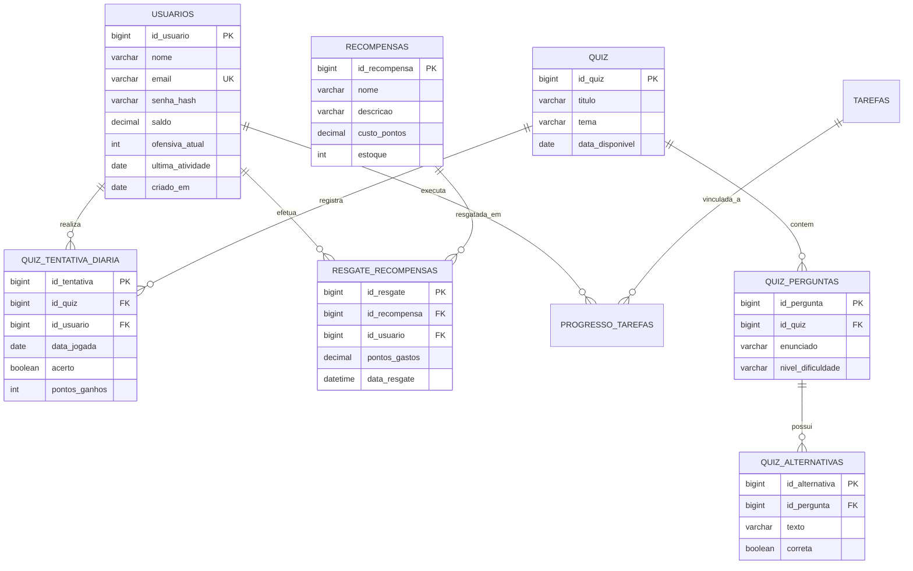

# 🌱 Ambientiza API - Plataforma Gamificada de Educação Ambiental

> **Projeto Acadêmico A3 — Universidade Anhembi Morumbi**  
> **Tema:** 07 - Educação Ambiental Gamificada  
> **Orientadora:** Profa. Cassilene Assis  
> **Integrantes:**  
> - Arthur Rodrigues de Andrade
> - Samuel Trovó Botelho 
> - Rodrigo Gusmão Silva

---

## 📖 1. Visão Geral do Projeto

O **Ambientiza** é uma plataforma educacional web voltada ao público jovem que utiliza elementos de **gamificação (estilo Duolingo)** para promover práticas sustentáveis no dia a dia. 

A plataforma aborda o problema do baixo engajamento e dispersão no aprendizado de sustentabilidade por meio de:
1. **Missões e Quizzes Diários:** Aprendizado prático e dinâmico com perguntas contextualizadas em três grandes eixos ecológicos.
2. **Sistema de Ofensiva (*Streak*):** Incentivo ao hábito diário contínuo, contabilizando dias consecutivos de atividade.
3. **Loja de Recompensas Virtuais:** Troca de pontos acumulados por benefícios ecológicos e pedagógicos digitais com rigoroso controle transacional.

---

## 🛠️ 2. Stack Tecnológica

- **Linguagem & Plataforma:** Java 25 / OpenJDK
- **Framework Principal:** Spring Boot 4.1.x
- **Persistência de Dados & ORM:** Spring Data JPA / Hibernate
- **Banco de Dados:** 
  - Produção/Dev: MySQL
  - Testes/Local: H2 Database em memória (console ativo em `/h2-console`)
- **Validação de Dados:** Jakarta Bean Validation (Hibernate Validator)
- **Documentação de API:** OpenAPI 3 / Swagger UI (`springdoc-openapi`)
- **Arquitetura:** RESTful API com separação em camadas (*Controller*, *Service*, *Repository*, *Model*, *DTO*).

---

## 📐 3. Modelo de Dados e Relacionamentos (DER)



---

## ⚡ 4. Principais Regras de Negócio Implementadas

### A. Sistema de Quizzes com Controle de Tentativas (Obrigatório)
- Cada usuário tem direito a **apenas 1 tentativa por dia** em cada quiz (`uq_usuario_quiz_dia`).
- Tentativas adicionais na mesma data são bloqueadas lançando `TentativaJaRealizadaException` (HTTP 400).
- Pontuação atribuída com base na dificuldade da pergunta:
  - **FÁCIL:** 10 pontos
  - **MÉDIO:** 20 pontos
  - **DIFÍCIL:** 30 pontos
- Responder ao quiz aciona automaticamente a verificação de **Ofensiva (*Streak*)** e credita os pontos no saldo do usuário de forma transacional.

### B. Mecânica de Ofensiva (*Streak* estilo Duolingo)
- **Primeiro acesso:** Define ofensiva como `1`.
- **Acesso no mesmo dia:** Mantém a contagem atual (sem duplicidade).
- **Acesso em dia consecutivo (ontem $\rightarrow$ hoje):** Incrementa a ofensiva em `+1`.
- **Ausência superior a 1 dia:** Quebra de sequência; a ofensiva é reiniciada para `1`.

### C. Loja e Transações de Recompensas (Obrigatório)
- Controle atômico com `@Transactional`:
  1. Verifica disponibilidade de estoque (`estoque > 0`).
  2. Verifica suficiência de saldo (`saldo >= custo`).
  3. Realiza o débito do saldo e baixa de 1 unidade do estoque simultaneamente.
  4. Registra o resgate na tabela `resgate_recompensas` com carimbo de data/hora para fins de auditoria.
  5. Impede saldo negativo ou resgate duplicado por falta de estoque.

---

## 🚀 5. Como Executar a Aplicação Localmente

### Pré-requisitos
- **Java 21 ou 25** instalado e configurado no `PATH` (`java -version`).
- Terminal PowerShell, Bash ou CMD.
- Acesso à internet na primeira execução para download das dependências via Maven Wrapper.

### Passo 1: Clonar o Repositório ou Abrir a Pasta
```bash
cd c:\Users\Rodrigo\Desktop\ambientiza
```

### Passo 2: Compilar e Executar a API
Utilizando o Maven Wrapper embutido:

**Windows (PowerShell ou CMD):**
```powershell
.\mvnw.cmd spring-boot:run
```

**Linux / macOS:**
```bash
./mvnw spring-boot:run
```

A aplicação inicializará por padrão na porta **`8080`**.

### Passo 3: Acessar a Documentação Interativa (Swagger UI)
Com a aplicação em execução, acesse pelo navegador:
- 🌐 **Swagger UI:** [http://localhost:8080/swagger-ui.html](http://localhost:8080/swagger-ui.html)
- 📄 **OpenAPI JSON:** [http://localhost:8080/v3/api-docs](http://localhost:8080/v3/api-docs)
- 🗄️ **Console do Banco H2:** [http://localhost:8080/h2-console](http://localhost:8080/h2-console)  
  - *JDBC URL:* `jdbc:h2:mem:test`  
  - *User Name:* `sa`  
  - *Password:* *(deixar em branco)*

---

## 📬 6. Guia de Endpoints da API

### 👤 Módulo de Usuários (`/usuario`)

| Método | Endpoint | Descrição | Status Sucesso |
| :--- | :--- | :--- | :--- |
| `POST` | `/usuario/cadastrar` | Cadastra novo usuário com senha criptografada (SHA-256) | `201 Created` |
| `POST` | `/usuario/login` | Autentica usuário por email ou nome | `200 OK` |
| `GET` | `/usuario` | Lista simplificada de nomes (compatibilidade) | `200 OK` |
| `GET` | `/usuario/todos` | Lista completa de usuários com saldo e ofensiva | `200 OK` |
| `GET` | `/usuario/{id}` | Busca perfil seguro de um usuário por ID | `200 OK` |
| `PUT` | `/usuario/{id}` | Atualiza nome e email do usuário | `200 OK` |
| `PATCH` | `/usuario/{id}/senha` | Altera senha validando a senha atual | `204 No Content` |
| `GET` | `/usuario/{id}/ofensiva` | Consulta status da ofensiva (*streak*) | `200 OK` |
| `POST` | `/usuario/{id}/ofensiva` | Registra atividade manual e recalcula ofensiva | `200 OK` |
| `DELETE` | `/usuario/{id}` | Remove usuário | `204 No Content` |

---

### 🎁 Módulo de Recompensas (`/recompensas`)

| Método | Endpoint | Descrição | Status Sucesso |
| :--- | :--- | :--- | :--- |
| `POST` | `/recompensas` | Cadastra novo benefício no catálogo | `201 Created` |
| `GET` | `/recompensas` | Lista todo o catálogo da loja | `200 OK` |
| `GET` | `/recompensas/disponiveis` | Lista apenas itens com estoque ativo (`estoque > 0`) | `200 OK` |
| `GET` | `/recompensas/{id}` | Busca benefício por ID | `200 OK` |
| `PUT` | `/recompensas/{id}` | Atualiza dados e estoque de uma recompensa | `200 OK` |
| `PATCH` | `/recompensas/{id}/estoque` | Adiciona unidades ao estoque | `200 OK` |
| `POST` | `/recompensas/resgatar` | **Resgata recompensa com controle transacional de saldo** | `201 Created` |
| `GET` | `/recompensas/resgates/usuario/{id}` | Extrato de resgates efetuados por um usuário | `200 OK` |
| `GET` | `/recompensas/resgates` | Relatório de auditoria de todos os resgates | `200 OK` |
| `DELETE` | `/recompensas/{id}` | Exclui item (bloqueado se já possuir resgates) | `204 No Content` |

---

### 🧠 Módulo de Quiz (`/quiz`)

| Método | Endpoint | Descrição | Status Sucesso |
| :--- | :--- | :--- | :--- |
| `POST` | `/quiz` | Cadastra quiz completo (Perguntas e Alternativas) | `201 Created` |
| `GET` | `/quiz/hoje` | Busca o quiz disponível para a data de hoje | `200 OK` |
| `GET` | `/quiz/{id}` | Busca quiz por ID com perguntas e opções seguras | `200 OK` |
| `GET` | `/quiz` | Lista todos os quizzes cadastrados | `200 OK` |
| `GET` | `/quiz/tema/{tema}` | Filtra quizzes por tema (`GESTAO_RECICLAGEM`, etc.) | `200 OK` |
| `POST` | `/quiz/responder` | **Submete tentativa diária com validação de 1x/dia** | `200 OK` |
| `GET` | `/quiz/{id}/status/usuario/{id}` | Verifica se o usuário já jogou hoje | `200 OK` |
| `GET` | `/quiz/tentativas/usuario/{id}` | Histórico de tentativas do usuário | `200 OK` |
| `DELETE` | `/quiz/{id}` | Exclui quiz e dependências em cascata | `204 No Content` |

---

## 🧪 7. Executando a Suíte de Testes Unitários

O projeto conta com ampla cobertura de testes unitários com **JUnit 5** e **Mockito**, testando todas as ramificações de regras de negócio:

```powershell
.\mvnw.cmd test
```

Classes de teste inclusas:
- [UsuarioServiceTest.java](file:///C:/Users/Rodrigo/Desktop/ambientiza/src/test/java/com/ambientiza/api/services/UsuarioServiceTest.java): Validação de senhas, criação de conta, regras de streak (mesmo dia, dia consecutivo e quebra de sequência) e saldo.
- [RecompensaServiceTest.java](file:///C:/Users/Rodrigo/Desktop/ambientiza/src/test/java/com/ambientiza/api/services/RecompensaServiceTest.java): Transação de resgate, bloqueio por saldo insuficiente, bloqueio por falta de estoque e integridade referencial.
- [QuizServiceTest.java](file:///C:/Users/Rodrigo/Desktop/ambientiza/src/test/java/com/ambientiza/api/services/QuizServiceTest.java): Validação de gabarito único, pontuação por dificuldade, crédito automático de pontos e trava de 1 tentativa por dia.

---

## 📂 8. Estrutura de Diretórios

```
ambientiza/
├── src/
│   ├── main/
│   │   ├── java/com/ambientiza/api/
│   │   │   ├── controllers/      # Camada REST (Endpoints HTTP)
│   │   │   ├── dtos/             # Data Transfer Objects (Records com validação)
│   │   │   │   ├── quiz/
│   │   │   │   ├── recompensas/
│   │   │   │   └── usuarios/
│   │   │   ├── enums/            # NivelDificuldade, Status, Temas, Tipo
│   │   │   ├── exceptions/       # Exceções de negócio e GlobalExceptionHandler
│   │   │   ├── models/           # Entidades JPA mapeadas
│   │   │   ├── repositories/     # Repositórios Spring Data JPA
│   │   │   └── services/         # Regras de negócio e transações
│   │   └── resources/
│   │       └── application.properties
│   └── test/java/com/ambientiza/api/services/ # Testes unitários com Mockito
├── pom.xml
└── README.md
```
